# GRAVITY: VOID — схема взаимодействия модулей

## 1. Принцип: слабая связанность через EventBus и ECS

Системы не импортируют и не вызывают друг друга напрямую. Все взаимодействия идут через:

1. **World (ECS)** — системы читают и пишут компоненты сущностей.
2. **EventBus** — प्रकाशка/подписка (pub/sub) на события: столкновения, смерть, постройка, катастрофа, сохранение.
3. **Сервисы** (`PhysicsService`, `RenderService`, `AudioService`, `InputService`, `StorageService`) — единый доступ к внешним библиотекам.

## 2. Диаграмма модулей (Mermaid)

```mermaid
graph TD
    subgraph "Внешние библиотеки"
        PixiJS[PixiJS / WebGL]
        Matter[Matter.js]
        Howler[Howler.js / Web Audio]
        IDB[(IndexedDB)]
    end

    subgraph "Сервисы (DI)"
        RenderService[RenderService]
        PhysicsService[PhysicsService]
        AudioService[AudioService]
        StorageService[StorageService]
        InputService[InputService]
    end

    subgraph "Ядро ECS"
        World[World / ECS]
        EventBus[EventBus pub/sub]
        GameLoop[Game Loop 60 FPS]
    end

    subgraph "Системы (в порядке обновления)"
        InputSys[InputSystem]
        AISys[AISystem]
        PhysSys[PhysicsSystem]
        BuildSys[ConstructionSystem]
        InvSys[InventorySystem]
        EventSys[EventSystem Катастрофы]
        RenderSys[RenderSystem]
        SaveSys[SaveSystem]
    end

    subgraph "Плагины (модули, не меняют ядро)"
        Biomes[Биомы]
        Abilities[Способности]
        Items[Предметы / Крафт]
        AIMods[Типы ИИ]
    end

    %% Игровой цикл
    GameLoop --> InputSys
    GameLoop --> AISys
    GameLoop --> PhysSys
    GameLoop --> BuildSys
    GameLoop --> InvSys
    GameLoop --> EventSys
    GameLoop --> RenderSys
    GameLoop --> SaveSys

    %% Сервисы ↔ системы
    InputSys --> InputService
    InputService --> PixiJS
    AISys --> PhysicsService
    PhysSys --> PhysicsService
    PhysSys --> Matter
    BuildSys --> PhysicsService
    RenderSys --> RenderService
    RenderService --> PixiJS
    EventSys --> AudioService
    AudioService --> Howler
    SaveSys --> StorageService
    StorageService --> IDB

    %% Мир и события
    InputSys -->|Intent компоненты| World
    AISys -->|Command компоненты| World
    PhysSys -->|Transform| World
    PhysSys -->|CollisionEvent| EventBus
    BuildSys -->|StructureEvent| EventBus
    InvSys -->|ItemEvent| EventBus
    EventSys -->|Catastrophe| PhysSys
    EventSys -->|Catastrophe| RenderSys
    EventSys -->|Catastrophe| AudioService
    World <--> EventBus

    %% Плагины регистрируются в мире
    Biomes -->|компоненты + системы| World
    Abilities -->|компоненты + системы| World
    Items -->|компоненты + рецепты| World
    AIMods -->|поведение + спавн| World

    %% UI (отдельный слой над RenderService)
    UI[UI-слой: инвентарь, меню, HUD] --> RenderService
    InputSys --> UI
```



## 3. Пример цепочки события (подбор предмета)

```
1. InputSystem  →  пишет IntentInteract на сущности игрока
2. InventorySystem  →  читает IntentInteract + ближайший Item-компонент
3. InventorySystem  →  перемещает предмет в Inventory игрока, удаляет Item-сущность из World
4. InventorySystem  →  EventBus.emit("item-picked-up", {entity, item})
5. AudioService  →  играет звук подбора (по подписке на item-picked-up)
6. SaveSystem  →  помечает мир как грязный → автосохранение через таймер
7. RenderSystem  →  при следующем кадре Item не отрисовывается (сущность удалена)
```

Никакая система в этой цепочке не импортирует другую систему напрямую — только World и EventBus.

## 4. Слой UI

UI (инвентарь, меню паузы, экран катастрофы) живёт поверх RenderSystem на отдельном PixiJS-контейнере с własной камерой (безследующая за игровым миром). InputSystem в контексте меню перенаправляет события в UI-обработчики, а не в игровые системы.
