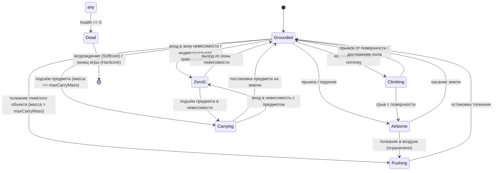

# GRAVITY: VOID — контроллер персонажа, параметры выживания и взаимодействие с миром

## 1. Обзор

Контроллер персонажа управляет базовыми действиями игрока: перемещение, прыжки, карабканье по стенам/потолкам, подъём/перенос/брос предметов, толкание тяжёлых объектов, копание, сканирование. Все действия завязаны на параметры выживания (Здоровье, Энергия, Выносливость, Состояние оборудования) и интегрированы с ECS-системой гравитации.

Персонаж — обычная ECS-сущность с набором компонентов. Логика распределена между системами:
- `CharacterSystem` — стейт-машина, перемещение, состояние земли/воздуха/карابينга
- `StaminaEnergySystem` — расход и восстановление выносливости/энергии
- `GrabThrowSystem` — захват, перенос, бросок, толкание объектов
- `DeathSystem` — обработка смерти (Softcore / Hardcore)

---

## 2. Параметры выживания (CharacterStats)

| Параметр | Диапазон | Описание | Восстановление |
|----------|----------|----------|----------------|
| `health` | 0 … `maxHealth` | Здоровье. При 0 — смерть. | Медикаменты, отдых, natuurная регенерация (медленно) |
| `maxHealth` | > 0 | Максимальное здоровье. Зависит от экипировки и технологий. | — |
| `stamina` | 0 … `maxStamina` | Выносливость. Тратится на бег, прыжки, карабканье, перенос, копание. | В покое, быстрее при сидении |
| `maxStamina` | > 0 | Максимальная выносливость. | — |
| `energy` | 0 … `maxEnergy` | Энергия. Тратится на сканирование, способности, поддержание оборудования. | Со временем, от источников энергии, отдых |
| `maxEnergy` | > 0 | Максимальная энергия. | — |
| `equipmentCondition` | 0 … 1 | Состояние оборудования (костюм, инструменты). При 0 — штрафы к характеристикам. | Ремонт инструментами/верстаком |

### Пороги и состояния

| Состояние | Условие | Эффект |
|-----------|---------|--------|
| `healthy` | `health > 0.6 * maxHealth` | Нет штрафов |
| `wounded` | `0.3 * maxHealth < health <= 0.6 * maxHealth` | -20% скорость, -30% выносливость |
| `critical` | `0 < health <= 0.3 * maxHealth` | -50% скорость, нельзя бегать, нельзя карабкаться |
| `dead` | `health <= 0` | Смерть (см. раздел 7) |
| `exhausted` | `stamina <= 0` | Cannot run/jump/climb. Medленное восстановление continues |
| `low-energy` | `energy <= 0.2 * maxEnergy` | Способности недоступны, сканирование медленнее |

---

## 3. Стейт-машина персонажа

Состояния зависят от гравитации, поверхности под ногами и текущего действия.

### 3.1 Состояния

| Состояние | Описание | Доступные действия |
|-----------|----------|-------------------|
| `Grounded` | Персонаж стоит на поверхности под влиянием гравитации | Ходьба, бег, прыжок, подъём предмета, копание, сканирование |
| `Airborne` | Персонаж в воздухе (прыжок, падение) | Прыжок повторно (если double jump), захват объекта в воздухе (ограниченно) |
| `Climbing` | Карабканье по стене или потолку (ориентация гравитации персонажа перпендикулярна поверхности) | Движение вдоль поверхности, прыжок от поверхности, подъём маленького предмета |
| `Carrying` | Перенос предмета (в руках) | Ходьба, медленное карабканье (если предмет лёгкий), бросок, постановка на землю |
| `ZeroG` | Невесомость (индивидуальная гравитация = 0 или зона невесомости) | Полёт в любом направлении, захват объектов, толкание |
| `Pushing` | Толкание тяжёлого объекта (масса > maxCarryMass) | Движение объекта медленно, нельзя бегать и прыгать |
| `Dead` | Смерть | Нет действий |

### 3.2 Диаграмма переходов (Mermaid)



### 3.3 Прави переходов с учётом гравитации

- **Прыжок:** приложить импульс против текущего вектора гравитации персонажа (`orientation` из `IndividualGravity`). Сила прыжка умножается на `gravityScale`.
- **Карабканье:** доступно, если персонаж касается поверхности, нормаль которой отклонена от вектора гравитации на > 45°, и `stamina > 0`. При карабканье по потолку гравитация персонажа инвертируется (`override` = противоположный вектор).
- **Невесомость:** если `gravityScale == 0` или персонаж в зоне `falloff = 1` с нулевым вектором — состояние `ZeroG`. Движение — прямое применение силы в направлении ввода без эффекта "пола".
- **Перенос тяжести (Carrying):** если несущий предмет имеет массу > 0.3 * maxStamina'équivalent, состояние переходит в `Carrying` со снижением скорости на 30% и ускоренным расходом стамины.

---

## 4. Математика выносливости и энергии

### 4.1 Выносливость (Stamina)

Расход в секунду (`dt` — шаг физики):

```
stamina_dt = -(
    moveCost        * isMoving      +
    sprintCost      * isSprinting   +
    jumpCost        * jumpEvent     +
    climbCost       * isClimbing    +
    carryCost       * carriedMass   +
    digCost         * isDigging
) * dt
```

| Действие | Стоимость (ед./сек) | Условие |
|----------|---------------------|---------|
| Ходьба | 2.0 | `isMoving && !isSprinting` |
| Бег | 8.0 | `isMoving && isSprinting` |
| Прыжок | 15.0 | разово при нажатии |
| Карабканье | 6.0 | `isClimbing` |
| Перенос предмета | 3.0 * (mass / maxCarryMass) | `isCarrying` |
| Копание | 10.0 | `isDigging` |

**Восстановление:**
- В полном покое (без движения, без Actions): `+12.0 / сек`
- При сидении/лежа: `+20.0 / сек`
- Порог "exhausted": `stamina <= 0` — все действия requiring stamina блокируются до восстановления до `0.2 * maxStamina`.

### 4.2 Энергия (Energy)

```
energy_dt = -(
    scanCost        * isScanning    +
    abilityCost     * activeAbilities +
    equipmentMaintenanceCost * equipmentConditionPenalty
) * dt + regenRate * dt
```

| Действие | Стоимость (ед./сек) |
|----------|---------------------|
| Сканирование (сканер) | 5.0 |
| Активная способность (teleport, gravity-well) | 10.0 … 40.0 |
| Поддержание повреждённого оборудования | 2.0 * (1 - condition) |

**Восстановление:**
- Базовое: `+4.0 / сек`
- От источника энергии (зарядная станция): `+20.0 / сек`
- От еды/стимулятора: разово `+25.0 … 100.0`

---

## 5. Физика захвата (Grab) и броска (Throw)

### 5.1 Захват

Условия захвата объекта:
1. Объект в радиусе досягаемости (`grabRadius = 2.5` единиц)
2. `mass <= maxCarryMass` персонажа — можно поднять и носить
3. `mass > maxCarryMass` — только толкание (состояние `Pushing`)
4. `stamina > 5` — минимальный порог для начала захвата

При захвате:
- Создаётся componentes `Grabbing` на персонаже и `Grabbed` на объекте
- Объект отсоединяется от физического мира (или становится kinematic, следует за рукой персонажа с смещением)
- Персонаж переходит в состояние `Carrying`
- Расход стамины: `carryCost` в секунду

### 5.2 Толкание тяжёлых объектов

Если `mass > maxCarryMass`:
- Персонаж входит в состояние `Pushing`
- Прикладывается сила к объекту в направлении движения персонажа
- Скорость персонажа снижена на 50%
- Прыжок и бег недоступны

### 5.3 Брос

```
throwForce = throwBaseForce * (1 + staminaBonus) / objectMass
```

| Параметр | Значение | Описание |
|----------|----------|----------|
| `throwBaseForce` | 500 | Базовая сила броска (Н·с) |
| `staminaBonus` | 0 … 1.0 | Зависит от текущей выносливости (% от max) |
| `objectMass` | кг | Масса бросаемого объекта |

- Брос потребляет `10 + mass * 2` ед. стамины
- После броска персонаж возвращается в `Grounded` / `Airborne` / `ZeroG`
- Объект получает импульс в направлении взгляда персонажа + вертикальная составляющая (угол броска 15–45°)

### 5.4 Ограничения по массе

| Диапазон массы | Доступное действие |
|----------------|-------------------|
| `mass <= 0.25 * maxCarryMass` | Лёгкий: поднимать одной рукой, быстро бегать, полноценный бросок |
| `0.25 < mass / maxCarryMass <= 1.0` | Тяжёлый: снижение скорости 30%, ускоренный расход стамины |
| `mass > maxCarryMass` | Только толкание (Pushing), нельзя поднять |

---

## 6. Копание и сканирование

### 6.1 Копание (Digging)

- Требует инструмент (лопата, кирка) с `equipmentCondition > 0`
- Расход: `stamina 10.0 / сек`, `energy 2.0 / сек`
- Скорость копания зависит от прочности материала (`Material.strength`) и состояния инструмента
- При `equipmentCondition <= 0` — копание недоступно, штраф к скорости перемещения

### 6.2 Сканирование (Scanning)

- Активное сканирование области (биом, объект, существо)
- Расход: `energy 5.0 / сек`
- Результат: отображение свойств объекта, обнаружение скрытых ресурсов, гравитационных аномалий
- Требует сканер в инвентаре

---

## 7. Логика смерти (Softcore / Hardcore)

### 7.1 Общие шаги при `health <= 0`

1. Персонаж переходит в состояние `Dead`
2. Все действия блокируются
3. Гравтация персонажа сбрасывается к глобальной (или 개인ной, если задано)
4. Инвентарь помечается как "drop-on-respawn"
5. Эмитит событие `player:died` в EventBus

### 7.2 Softcore (лёгкое выживание)

| Аспект | Поведение |
|--------|-----------|
| Возрождение | На последней точке сохранения (спавн/база) |
| Технологии и способности | Сохраняются навсегда (разблокировки переносятся) |
| Инвентарь | Часть ресурсов теряется (drop на месте смерти, можно собрать обратно за N времени) |
| Оборудование | Частичная потеря прочности (`equipmentCondition -= 0.1 … 0.3`) |
| Сохранение | Доступно (автосейв + ручное) |
| Штраф | Дебафф "напряжение" на 5 минут: -20% стамины и энергии |

### 7.3 Hardcore (перманентная смерть)

| Аспект | Поведение |
|--------|-----------|
| Возрождение | Недоступно |
| Технологии и способности | Потеряны |
| Инвентарь | Полностью теряется (мир не сохраняет инвентарь этого персонажа) |
| Оборудование | Потеряно |
| Сохранение | Заблокировано (кнопки сохранения недоступны, автосейв отключён) |
| Мир | Возможен вариант "мир остаётся, персонаж удаляется" или "полное удаление мира" |

### 7.4 Псевдокод обработки смерти

```
function onPlayerDeath(entity):
    world.addComponent(entity, Dead, { time: now })
    eventBus.emit('player:died', { entity, mode: gameMode })

    if gameMode == 'softcore':
        dropInventoryAt(entity, position, keepPercentage = 0.7)  // 30% теряется
        applyDebuff(entity, 'exhaustion', duration = 300)       // 5 мин
        scheduleRespawn(entity, spawnPoint, delay = 3.0)
    else if gameMode == 'hardcore':
        lockSaving()
        dropAllInventory(entity, position)
        markCharacterPermanentlyDead(entity)
        showGameOverScreen()
```

---

## 8. Интеграция с системой гравитации

- `IndividualGravity.orientation` определяет, где "пол" для персонажа — используется для анимации, направления прыжка и карабканья
- В состоянии `Climbing` по стене/потолку `IndividualGravity.useOverride = true`, `override` = противоположный нормали поверхности
- В `ZeroG` `IndividualGravity.scale = 0`, движение — прямое применение силы в направлении ввода
- При подъёме предмета масса предмета складывается с массой персонажа при расчёте силы гравитации (`PhysicsSystem` применяет F = m_total * G_eff)

---

## 9. Структура кода

| Файл | Содержимое |
|------|------------|
| `docs/07-character-controller.md` | Эта спецификация |
| `src/components/character.ts` | `CharacterController`, `CharacterStats`, `Dead`, `RespawnPoint` |
| `src/components/grab.ts` | `Grabbing`, `Grabbed`, `Pushable` |
| `src/systems/character-system.ts` | Стейт-машина, перемещение, прыжки, карабканье |
| `src/systems/stamina-energy-system.ts` | Выносливость и энергия |
| `src/systems/grab-throw-system.ts` | Захват, перенос, бросок, толкание |
| `src/systems/death-system.ts` | Обработка смерти Softcore/Hardcore |
| `src/main.ts` | Регистрация новых компонентов и систем |
